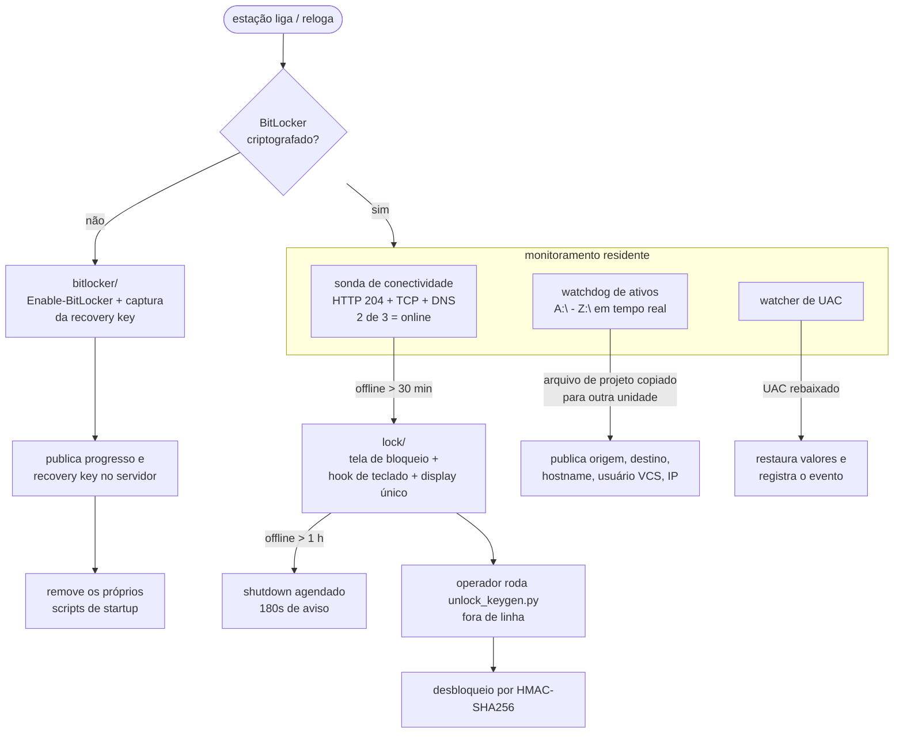

# workstation-security-suite

> Automação de segurança de endpoints Windows: BitLocker orquestrado, lock de estação por perda de conectividade, detecção de cópia indevida de ativos e auditoria contínua de instalação.

     

     

## O problema

Num estúdio de jogos, o risco número um não é ataque externo — é **propriedade intelectual vazando pela porta da frente**: conteúdo de um projeto não lançado copiado para um HD externo, ou uma estação levada para casa sem criptografia.

Este conjunto resolve isso com **automação em vez de política**: cada estação se auto-endurece, reporta o próprio estado e se tranca sozinha quando algo sai do normal.

## Arquitetura

```
workstation-security-suite/
├── bitlocker/    habilita BitLocker, captura e publica a recovery key, valida TPM
├── lock/         lock de estação por queda de conectividade + keygen HMAC
├── monitor/      watchdog de ativos, watcher de UAC, agente autônomo
├── audit/        leitura do Event Log de Segurança (EventID 4663)
├── onboarding/   renomear PC/usuário, tag de máquina e de VCS
├── disk/         letra de unidade, remoção de volume
├── vcs/          varredura e atualização de working copies SVN
├── remote/       provisionamento de acesso remoto
├── ui/           telas de bloqueio e aviso de criptografia
└── scripts/      helpers de startup/remoção
```

## Fluxo de uma estação



## Destaques técnicos

### 🔐 Lock por conectividade — `lock/lock_workstation.py`

- **Duas fases**: `LOCK_THRESHOLD_MINUTES = 30` offline → trava; `SHUTDOWN_THRESHOLD_HOURS = 1` offline → shutdown agendado com `schedule_shutdown_after_delay(180)`, ou seja 180s de aviso antes do desligamento. Polling a cada `INTERNET_POLL_SECONDS = 60`.
- **Sonda de conectividade por consenso de 3 vias**: HTTP 204 (`connectivitycheck.gstatic.com`), TCP e DNS — precisa de **2 de 3** para considerar online. Isso evita falso positivo de captive portal, que responde a DNS mas não tem internet real.
- **Estado que sobrevive a restart**: se a estação for reiniciada durante uma queda, o agente relê o banco local de conectividade e volta a travar imediatamente. A marcação de queda só é limpa após desbloqueio bem-sucedido.
- **Desbloqueio por HMAC-SHA256**: a estação mostra um ID de sessão (aleatório por execução, `secrets.randbelow`) e o operador roda `lock/unlock_keygen.py` offline para gerar a chave de 12 caracteres (base64-url, truncado). O `HMAC_SECRET` é lido do ambiente **na própria estação bloqueada** e a validação acontece localmente — o keygen offline serve para o operador não carregar o segredo no bolso, não é uma fronteira de segurança: quem tem acesso à máquina bloqueada tem acesso ao segredo.
- **Defesa contra burla ativada só sob lock** (não no boot): hook global de teclado de baixo nível (`KBDLLHOOKSTRUCT` via `ctypes`) bloqueando Alt+Tab / Alt+F4 / Ctrl+Shift+Esc, `DisableTaskMgr` no registro, display único via `DisplaySwitch.exe /internal`. O watchdog de `taskmgr` **não re-tapa o Gerenciador de Tarefas**: ao detectar o processo aberto ele trata como tentativa de burla e escala — dispara `trigger_bitlocker_recovery('C:')` e `shutdown /s /f /t 0` imediato (`check_task_manager_thread`, linhas 561-590).

### 💾 BitLocker orquestrado — `bitlocker/`

- Habilita via PowerShell: `Enable-BitLocker -MountPoint C: -RecoveryPasswordProtector -SkipHardwareTest -UsedSpaceOnly -EncryptionMethod XtsAes128`.
- Captura a recovery key com `Get-BitLockerVolume -MountPoint 'C:' | KeyProtector | Where KeyProtectorType -eq 'RecoveryPassword'`, grava em `<COMPUTERNAME>_Bitlocker.txt` e publica no Realtime Database.
- `manage-bde -status` é usado para monitorar o progresso da criptografia; `manage-bde -protectors <drive> -disable` + `gpupdate /force` bloqueiam os protectors dos demais discos.
- Pré-checagem de TPM via `Get-Tpm` em PowerShell — o código avalia **`TpmEnabled`** para decidir se segue (`TpmPresent`/`TpmReady` são impressos mas não entram na decisão), com popup informando fabricante, versão e data da BIOS lidos de `Win32_BIOS`/`Win32_BaseBoard` quando o TPM não está pronto.
- `recovery_key_handler.py` renomeia o arquivo de recuperação para `<hostname> - <username>` antes de movê-lo para o share central — sem renomear, dez máquinas produzem dez arquivos com o mesmo nome e ninguém sabe de quem é qual. (O caminho de origem dele está fixado como `~/Documents/a.txt`; é ferramenta de operador, não fluxo automático.)
- **Auto-limpeza**: quando a criptografia é confirmada, o script apaga os próprios `bitlocker_startup.bat` / `drive_letter_startup.bat` dentro do diretório do agente. A cópia inicial para a pasta de inicialização do Windows era feita pelo deploy externo (não incluído); `scripts/remove_startup_entry.bat` remove a entrada de Startup quando existe.

### 👁️ Detecção de cópia indevida — `monitor/asset_watch_guard.py`

`watchdog.Observer` agendado recursivamente sobre o disco do script **e sobre todos os demais discos presentes** (varre `A:\`–`Z:\` via `os.path.exists`). O handler reconstrói o caminho de origem do arquivo modificado e, quando a unidade de origem é diferente da unidade do evento **e o arquivo de origem existe**, casa os termos da watch-list contra os dois caminhos.

A watch-list tem uma parte estática (termos literais casados por **substring**, sem glob: `Content`, `Source`, `Plugins`, `Build`, `Config`, `Binaries`, `Intermediate`, `DerivedDataCache`, `Saved`, `Maps`, `Meshes`, `Textures`, `Materials`, `Blueprints`, `Animations`, `Audio`, `ProjectAlpha.uproject`, `ProjectAlpha.png`) e uma parte dinâmica baixada do servidor em `fetch_watch_list_from_firebase()`. Quando bate, publica origem, destino, timestamp, hostname, usuário do VCS (lido de `%APPDATA%\Subversion\auth\svn.simple`), **IP público de saída** (via `api.ipify.org` — não o IP local da interface) e a cidade aproximada desse IP (via `ipinfo.io`).

### 📡 Agente autônomo — `monitor/cerberus_agent.py`

Coleta regras de firewall via PowerShell e programas instalados via registro, mede a latência de cada nó de monitoramento e escolhe o mais rápido, mantém keep-alive WebSocket (`wss`) e grava o estado local **cifrado com Fernet**. Download de payload com até 5 tentativas e **verificação real de integridade**: recalcula o SHA-256 do arquivo baixado, compara com o checksum enviado e **apaga o arquivo** se divergir.

### 📋 Auditoria de instalação — `audit/install_event_auditor.py`

Varre o log de Segurança do Windows (`win32evtlog`, leitura reversa e sequencial) filtrando `EventID == 4663` e publica usuário, data/hora e mensagem formatada (`win32evtlogutil.SafeFormatMessage`) no Realtime Database.

**Este módulo tem um bug conceitual que eu conheço.** EventID 4663 é *"An attempt was made to access an object"* — não é evento de instalação de software. O comentário no código diz "instalação de software" e o `software_name` publicado é hardcoded `"Software Desconhecido"`. Na prática o que ele produzia era um registro de acessos a objetos, que servia como sinal aproximado de instalação (instalar software gera acesso a arquivos), mas **não é a fonte correta**. A abordagem certa seria `Win32_Product` / chave `Uninstall` do registro, ou os EventIDs 101/103 do log de Aplicativo (Windows Installer). Mantive o módulo como está porque é o que estava em produção — mas ele está marcado aqui e no código como a parte mais fraca da suíte.

## ⚠️ Nota de segurança sobre a custódia das recovery keys

O fluxo publica a **recovery key em texto claro** no Realtime Database (`/recovery_keys.json`). Na época isso resolveu um problema operacional real — técnico nenhum precisava subir na estação para resgatar a chave — mas é a decisão mais questionável da suíte: quem tem acesso àquela base consegue descriptografar qualquer disco da frota. A correção é cifrar a chave antes de publicar (com a chave mestra fora da base), ou publicar apenas um identificador e guardar a chave num cofre com controle de acesso e auditoria. Está marcado aqui de propósito.

## ⚠️ Nota de segurança sobre o lock

O lock roda como usuário, não como serviço protegido. Ele **dissuade e atrasa** — não resiste a alguém com mídia de boot e acesso físico. A proteção real de dados vem do BitLocker; o lock existe para cobrir o intervalo entre "a estação sumiu" e "alguém chegou nela".

## ⚠️ Limitação de TLS que eu reconheço

`monitor/cerberus_agent.py` conecta nos nós de monitoramento com `cert_reqs: ssl.CERT_NONE` e `check_hostname: False` em todos os 5 pontos de conexão. Isso foi feito porque os nós usavam certificado autoassinado num ambiente fechado, mas **é a escolha errada**: aceita qualquer certificado apresentado por qualquer host na rede. A correção é distribuir a CA interna e validar a cadeia, ou usar pinning de certificado. Está marcado no código de propósito — não quero que pareça que eu não sei o que o parâmetro faz.

## Testes e lint

```bash
pip install -r requirements.txt -r requirements-dev.txt
ruff check .          # lint
pytest                # 15 testes
```

O CI roda lint, `compileall` e pytest em `windows-latest` (Python 3.11 e 3.12) a cada
push — Windows porque este código usa `pywin32`, `wmi` e `winreg`, que não existem em Linux.

A configuração do ruff está em `pyproject.toml` e declara, com o motivo de cada uma, as
regras que **não** estou corrigindo agora. Prefiro isso a escolher um subconjunto de regras
que passa por acaso.

## Setup

```bash
python -m venv .venv
.venv\Scripts\activate
pip install -r requirements.txt
copy .env.example .env   # Windows (cp .env.example .env em Linux/macOS)
```

### Como rodar

Cada script é independente — não há um binário único. Os executáveis reais:

```powershell
# habilita BitLocker, captura a recovery key e reporta progresso
python bitlocker/auto_enable_bitlocker.py

# so checa o estado de criptografia (nao altera nada)
python bitlocker/check_encryption.py

# trava a estacao por queda de conectividade
python lock/lock_workstation.py

# roda FORA da estacao bloqueada: gera a chave de desbloqueio a partir do ID exibido
python lock/unlock_keygen.py

# watchdog de copia de ativos
python monitor/asset_watch_guard.py

# agente de inventario/heartbeat (usa Fernet para o estado local)
python monitor/cerberus_agent.py

# watcher de UAC (reverte rebaixamento e registra o evento)
python monitor/uac_watcher.py

# varredura do Event Log de Seguranca (ver a nota sobre EventID 4663 abaixo)
python audit/install_event_auditor.py

# renomeia a maquina (pede elevacao)
python onboarding/rename_computer.py

# atualiza working copies SVN
python vcs/update_repositories.py
```

Precisa de privilégios de administrador para BitLocker, registro e `shutdown`.

### Variáveis de ambiente

| Variável | Descrição |
|---|---|
| `FIREBASE_DATABASE_URL` | ver `.env.example` |
| `SEC_AGENT_DIR` | ver `.env.example` |
| `CHROME_RD_PIN` | ver `.env.example` |
| `HMAC_SECRET` | ver `.env.example` |
| `MONITOR_NODES` | ver `.env.example` |
| `AGENT_ENCRYPTION_KEY` | ver `.env.example` |
| `RECOVERY_SHARE_PATH` | ver `.env.example` |
| `WATCH_DIR` | ver `.env.example` |
| `SCAN_ROOT` | ver `.env.example` |
| `COMPANY_EMAIL_DOMAIN` | ver `.env.example` |

---

## ⚠️ Sobre o que isto é — e sobre titularidade

São **scripts internos de TI** escritos durante meu trabalho em um estúdio de jogos, **sanitizados** para publicação: tokens, senhas, hosts internos, IPs, nomes de projeto e dados de terceiros foram substituídos por variáveis de ambiente ou placeholders. O estúdio não é nomeado aqui de propósito.

Duas coisas que quero deixar claras em vez de deixar você descobrir:

- **Não estou reivindicando direitos sobre este código.** Parte dele foi produzida como funcionário, e direitos sobre trabalho de empregador pertencem ao empregador. Publico como demonstração de como eu resolvi os problemas — para leitura e estudo, não como software livre. Não há licença concedida (ver `LICENSE`).
- **Não são produtos prontos para produção.** São demonstrações de abordagem técnica, com limitações declaradas nas seções acima. Copie `.env.example` para `.env` e preencha antes de rodar qualquer coisa — e rode só contra infraestrutura sua.
